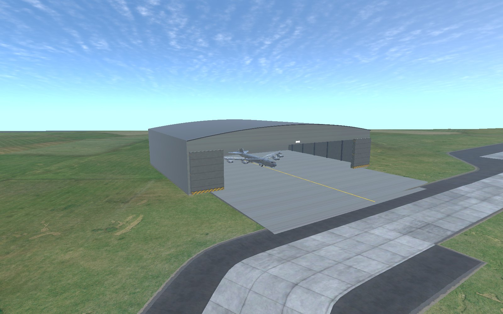
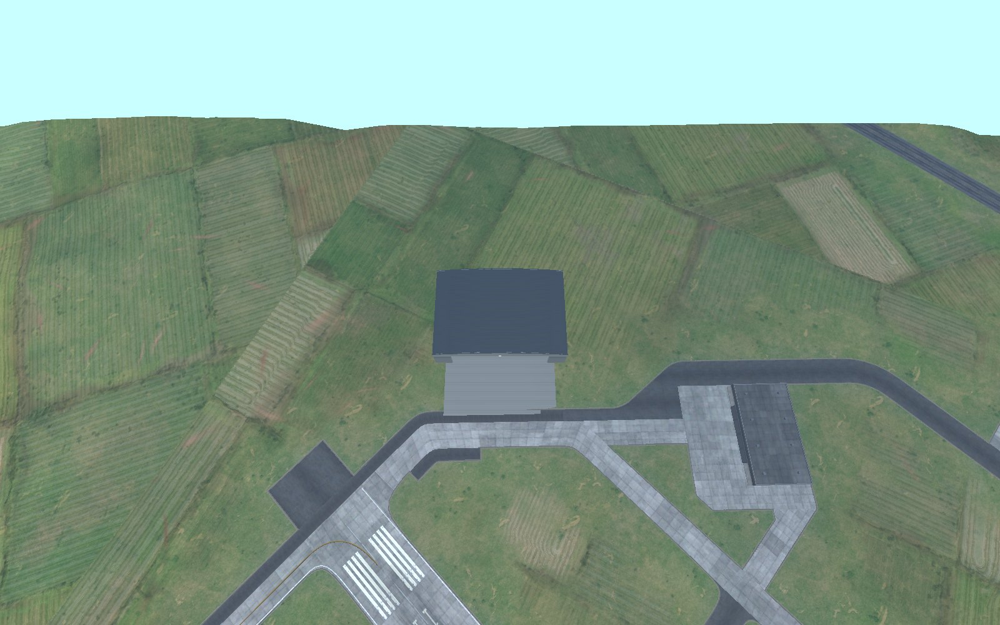
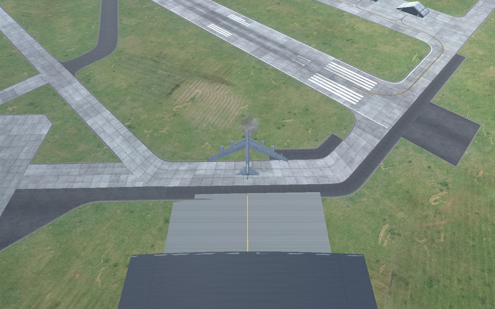

# Heavy Aircraft Hangar for Nuclear Option

A hangar large enough to spawn the biggest aircraft in Nuclear Option (built for the B-52, it fits any other aircraft too),
plus a small plugin that places it at airbases and sends oversize aircraft to it. Made with
[Blueprinter](https://github.com/nikkorap/NOBlueprinter-Releases).

## The building

| | |
|---|---|
| Outside | 114 m wide, 78 m deep, 22 m eaves, 27 m ridge, plus a 46 m concrete apron |
| Door | 84 m x 17 m, three telescoping leaves per side stacking into 14 m pockets |
| Fits | B-52 (56.4 m span, 12.4 m tall) with 13.8 m each side and 4.6 m over the fin |
| Stock hangar_med for comparison | ~46 m x 8 m door, 80 x 45 m building |

Steel portal frames, arched roof, ceiling lamps that come on at night, a warning lamp over the door while it moves,
taxi line out to the apron. A 6 m concrete foundation skirt hides gently sloping ground.

In game it's `Heavy Aircraft Hangar` (json key `hangar_heavy`). It behaves like any stock hangar: it can be
damaged, repaired and captured with its airbase.

## How aircraft use it (plugin `HeavyHangar.dll`)

- **Routing**: an aircraft wider than 44 m or taller than 9 m (both configurable) won't spawn from a stock hangar
  when its airbase has a working heavy hangar. The airbase uses the heavy hangar instead.
- **What it offers**: everything the airbase's other hangars list. It never adds or removes aircraft types from a
  base, so mission and faction restrictions still apply.
- **No heavy hangar at the base**: oversize aircraft spawn on the ground just outside the stock hangar's door,
  instead of inside a building they don't fit.

## Where it appears

- **Automatically** (config `AutoPlace`, on by default): when a mission starts, the host puts one at each land
  airbase whose longest takeoff runway is at least 1,800 m, against one of the airbase's own taxiways:
  - the apron's front edge overlaps the taxiway edge, level with it to within 0.3 m (a sloped lip covers the
    rest), and the door faces the taxiway, so aircraft roll from the apron straight onto the taxi network;
  - sites nearest a runway end are tried first, so a heavy aircraft gets the whole runway;
  - the rest of the footprint must be bare, nearly flat terrain (within 5 m), clear of buildings, vehicles and
    water, and at least 75 m outside every runway's edges and 300 m past its ends.

  Only if no taxiway site fits does it fall back to a site beside the runway, which has no paved link (the log
  says so). It retries for about five minutes in case terrain around distant airbases hadn't loaded yet. Clients
  receive it through normal network spawning.

  
  
- **Mission editor**: it's listed with the other buildings and can be attached to any airbase. An airbase that
  already has one is skipped by automatic placement.

## Config (`BepInEx/config/com.ironman1213.heavyhangar.cfg`)

Placement runs on the host (or server) only, so only the host's `Placement` settings count. Routing is decided on
the host too; keep `Routing` the same on every player's PC so the aircraft menu matches what the host spawns.

| Key | Default | |
|---|---|---|
| Placement.AutoPlace | true | add one per eligible airbase at mission start |
| Placement.MinRunwayLength | 1800 | metres |
| Routing.OversizeSpan | 44 | metres; wider aircraft prefer heavy hangars |
| Routing.OversizeHeight | 9 | metres |
| Debug.VerboseLog | false | log each rejected site and why |

## Install
**Mod manager:** it's listed on [NOMNOM](https://github.com/KopterBuzz/NOMNOM), so mod managers that use it (such as NOMM) can install and update it.

**By hand:**
1. Install [BepInEx 5](https://github.com/BepInEx/BepInEx) and [Blueprinter](https://github.com/nikkorap/NOBlueprinter-Releases)
   2.0.1 or newer.
2. Download `Heavy-Hangar_x.y.z.zip` from the [latest release](https://github.com/IornMan1213/NO-HeavyHangar/releases).
3. Put `Heavy Hangar_x.y.z.nobp` and `HeavyHangar.dll` in `BepInEx/plugins/HeavyHangar/`. Delete older versions first.

Every player in a multiplayer game needs it (Blueprinter compares mod sets when you join). Without the DLL the building still
exists in the mission editor, but nothing places it automatically or routes aircraft to it.

## Repository layout
| Path | Contents |
|---|---|
| `plugin/HeavyHangar/` | The BepInEx plugin (`HeavyHangar.dll`): placement, routing, outside-door fallback. MIT, built with `dotnet build -c Release` against an installed game. |
| `tools/blender_hangar.py` | The building, modelled procedurally in Blender (frames, roof, telescoping doors, lamps) and exported to FBX. |
| `tools/make_hangar_textures.py` | The building's textures, drawn procedurally. |
| `unity/Editor/HangarBuilder.cs` | Unity editor script: builds the hangar prefab and definition (the game's hangar_med as the component donor) and the .nobp. |
| `tools/build_hangar.sh`, `tools/env.sh` | The full build (Linux, or Windows with Git Bash): `HH_UNITY_PROJECT=<a Blueprinter Editor project> bash tools/build_hangar.sh`. Writes the .nobp and the plugin to `build/`. |
| `tools/package.sh` | The release zip (`build/Heavy-Hangar_x.y.z.zip`) and its entry in `nomnom/HeavyHangar.json`. |

The same hangar files live in [NO-B52](https://github.com/IornMan1213/NO-B52) (it builds the hangar with the B-52 and
is where it's tested); the two copies are kept identical.

No game files are included: Blueprinter references the game's own assets at runtime.

## Licence
MIT (see LICENSE): the building, textures, scripts and plugin were all made for this mod.
Nuclear Option is (c) Shockfront Studios; this is an unofficial fan mod. Built with AI assistance (Claude).
